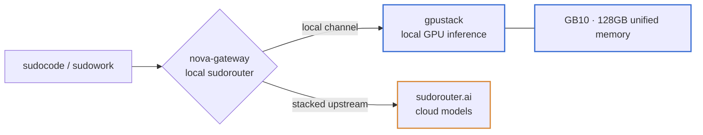

# sudoedge

Deployable package for the sudo stack on an edge GPU box (first target: NVIDIA
DGX Spark / GB10). One clone plus a provisioning run stands up the whole stack —
local GPU inference, the local router, and the host-level guardrails — so a new
box is reproducible from source.

## What it deploys

Full architecture and rationale: the design doc on ShareOne
(`s.shareone.vip/s/sudo-stack-on-dgx-spark-she`) — the source of truth for the
design; this repo holds the deployable artifacts.

## Layout
- `compose/` — the container stack (gpustack + nova-gateway), pinned.
- `scripts/bootstrap.sh` — host layer: package/image mirrors, cgroup memory reservations, the memory guard, the container runtime.
- `scripts/configure.sh` — the runbook steps as code: model deploy, channel registration, sudocode wiring.
- `docs/` — the design doc and the operator runbook (`SETUP.md`).

## Credential handling
The one upstream credential (the SaaS router key) reaches the edge just-in-time
and stays out of persistent storage: nova-gateway's state lives on a RAM-backed
volume, and `configure.sh` injects the cloud channel at deploy time. The repo and
images carry no secrets. Edge boxes reach production hardening via device-attested
access (TEE), where the raw key never lands on the box.
