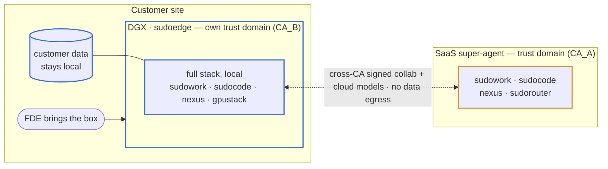
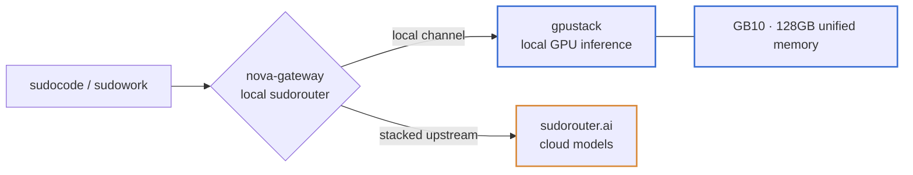

# sudoedge

The deployable **edge form** of the sudo stack — the box a forward-deployed
engineer (FDE) carries to a customer. It runs the full stack locally on a DGX
(first target: GB10), keeps customer data on-site, and collaborates with the
SaaS super-agent across a **cross-org trust boundary** (cross-CA signed,
privacy/compliance-preserving). One clone plus a provisioning run stands it up
from source; the box can be left at the customer.

## The scenario

The box is its **own** trust domain (self-signed CA_B) — it never joins our
cluster; its agents' authorship is verified cross-CA by the SaaS broker, and
only signed messages cross the boundary, never data.

## What it deploys

Full architecture and rationale: the design doc on ShareOne
(`s.shareone.vip/s/sudo-stack-on-dgx-spark-she`); cross-org authorship in
`nexus-auth-architecture` §5. This repo holds the deployable artifacts.

## Layout
- `compose/` — the container stack (gpustack + nova-gateway), pinned.
- `scripts/bootstrap.sh` — host layer: package/image mirrors, cgroup memory reservations, the memory guard, the container runtime.
- `scripts/configure.sh` — the runbook steps as code: model deploy, channel registration, sudocode wiring.
- `docs/` — the design doc and the operator runbook (`SETUP.md`).

## How results leave the box
The box carries its own **ShareOne** instance, so work produced on site is
drafted, reviewed and commented **inside** the box — the artifact surface stays
available with no egress at all, which is what an isolated site needs. What
leaves is a redacted deliverable, never the source data: when the box is
online, that deliverable can be pushed to the customer's Atlas ShareOne or to
the public one. Live collaboration with the SaaS super-agent rides the
cross-CA A2A channel instead (messages cross, data does not).

## Credential handling
The box carries its **own identity** (self-signed CA_B) for cross-org agent
authorship, and never receives our CA or joins our cluster. The one upstream
credential (the SaaS router key) reaches the edge just-in-time and stays out of
persistent storage — nova-gateway's state is RAM-backed, `configure.sh` injects
the cloud channel at deploy, and the repo/images carry no secrets. Production
hardening: device-attested (TEE) access so the raw key never lands on the box.
