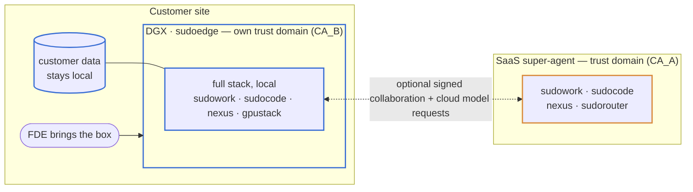
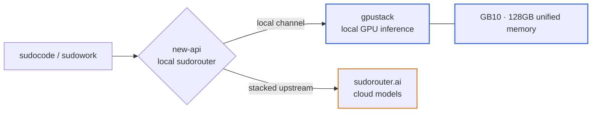

# sudoedge

The deployable **edge form** of the sudo stack — the box a forward-deployed
engineer (FDE) carries to a customer. Its target is a local stack on DGX
(first target: GB10) with optional cloud services across a separate trust
domain. Current deployment and acceptance evidence lives in `docs/SETUP.md`.
The local browser and inference path uses the cohost runtime by default;
cross-domain agent collaboration and content inspection remain tracked work.

## The scenario



The box is its **own** trust domain (self-signed CA_B) — it never joins our
cluster; its agents' authorship is verified cross-CA by the SaaS broker, and
cross-domain messages carry authenticated authorship. Message text, artifacts
and model prompts can contain customer data; signatures alone do not filter it.

## What it deploys



Full architecture and rationale: the design doc on ShareOne
(`s.shareone.vip/s/sudo-stack-on-dgx-spark-she`); cross-org authorship in
`nexus-auth-architecture` §5. This repo holds the deployable artifacts.
The current cloud/box target and migration checklist are maintained in
[Sudo Cloud architecture](https://s.shareone.vip/md/sudo-cloud-plan).

## Layout
- `compose/` — local new-api Router and Sudowork WebUI containers.
- `scripts/bootstrap.sh` — host layer: package/image mirrors, cgroup memory reservations, the memory guard, the container runtime.
- `scripts/configure.sh` — the runbook steps as code: model deploy, channel registration, sudocode wiring.
- `docs/` — the design doc and the operator runbook (`SETUP.md`).

## How results leave the box
The target deployment includes its own **ShareOne** instance, so work produced on site is
drafted, reviewed and commented **inside** the box — the artifact surface stays
available with no egress at all, which is what an isolated site needs. What
leaves is a redacted deliverable, never the source data: when the box is
online, that deliverable can be pushed to the customer's Atlas ShareOne or to
the public one. Live collaboration with the SaaS super-agent rides the
cross-CA A2A channel. Local ShareOne and the content inspection gate still need
deployment and acceptance; the current browser bring-up stores files in each
session's local workspace.

A model call is also an outbound transfer. The local GPU channel and its
credential use the `local` group. Configured cloud channels remain enabled in
the `external` group with a separate credential. The local credential cannot
reach that group, including when both groups advertise the same model ID and
the local GPU fails. The appliance starts online; an operator can persistently
stop public-network traffic:

```bash
sudo bash scripts/install-ops.sh
sudo sudoedge connectivity local     # stop public IPv4/IPv6 egress
sudo sudoedge connectivity online    # restore the host's normal network policy
sudoedge connectivity status
sudoedge status                      # connectivity + WebUI/Moss/Router reachability
sudoedge webui status
sudoedge model restore               # reapply the configured Nexus model mount
```

The policy covers host output and forwarded container traffic, including
existing connections. Private LAN, loopback, link-local discovery and DHCP
remain available. It restores before networking/Docker after boot and only
manages its own nftables table. It is an appliance network switch: LAN proxies
and publicly addressed on-premises networks need a site-specific policy.
Run `sudo bash tests/connectivity.sh` for the isolated network regression.

`sudoedge` is the operator entry point, installed by the command above and by
bootstrap. The `sudoedge.service` unit restores its persisted connectivity
mode during boot. Shared component contracts and assembly belong in
`sudostack`; device deployment, networking and operator commands belong here.
`status` checks service reachability; a healthy endpoint does not prove model
quality or a cloud login. No cloud credential means no usable cloud channel,
even when the network mode is online.

`configure-router.py` preserves existing cloud channels while moving them to
`external`, and removes the superseded shared token after writing the new
credentials. It preserves unrelated client providers and Router model metadata.
The `sudoedge-external` credential is reserved for a cloud model mount listed
in `NEXUS_EGRESS_GATE_MODEL_MOUNTS`; it must never replace the local `/model`
mount's `sudorouter` credential. Network connectivity and content filtering are
separate controls.

## Browser access on DGX

`compose/webui.yml` runs the real Sudowork WebUI with PostgreSQL. It connects
to local Moss on port 43127 and also allows selecting the configured cloud
Moss at login. Moss uses mTLS for its primary Nexus connection and a second
local mTLS identity for the cohost execution Nexus. Browser sessions now use
the production path `Moss → local ManagedAgentService → in-process scode →
Nexus /model → new-api → GPUStack` when `MOSS_DEFAULT_RUNTIME=cohost`.

Install the sudocode-provided ARM64 cohost binary and the appliance service
with:

```bash
bash scripts/install-cohost.sh /path/to/nexusd-cohost
```

Set `MOSS_COHOST_NEXUS_MODE`, `MOSS_COHOST_NEXUS_ENDPOINT`, the three
`MOSS_COHOST_NEXUS_TLS_*` paths and `MOSS_DEFAULT_RUNTIME=cohost` in the Moss
service environment. The runbook records the DGX acceptance session and
keeps the primary 22140 Nexus reserved for Moss vault and login traffic.

Build WebUI from the Sudowork repository's `apps/webui/Dockerfile`, then set
`WEBUI_IMAGE`, `POSTGRES_PASSWORD`, `SESSION_HMAC_KEY` and `TOKEN_AES_KEY` in
a private environment file and run:

```bash
docker compose --env-file webui.env -f compose/webui.yml up -d
```

On a laptop with SSH access to the box:

```bash
ssh -N -L 127.0.0.1:12808:127.0.0.1:26808 taolei@192.168.1.11
```

Open **http://localhost:12808** on the laptop running SSH. On Windows:

```powershell
.\scripts\open-webui.ps1
```

This installs the current user's `SudoEdge-WebUI-12808` scheduled task, starts
the tunnel, checks WebUI health and opens the browser. It reconnects after SSH
disconnects and starts again at Windows sign-in. It copies its helper into
`%LOCALAPPDATA%\SudoEdge-WebUI-12808`, with a bounded tunnel log there, so it
does not depend on a temporary checkout staying present. `-NoBrowser` checks
the connection without opening a window. Stop/remove it when no longer needed:

```powershell
Stop-ScheduledTask -TaskName SudoEdge-WebUI-12808
Unregister-ScheduledTask -TaskName SudoEdge-WebUI-12808 -Confirm:$false
```

This uses an encrypted LAN connection and
a localhost browser origin. WebUI and PostgreSQL listen only on loopback.
The box does not need Electron. Login credentials belong in password-agent,
not this repository or the architecture page.

What crosses those ways out is checked on the box's own kernel by the egress
content gate (nexus-vfs `egress_gate`): every write that passes through that
kernel onto an egress plane — a prompt to a model mount named in
`NEXUS_EGRESS_GATE_MODEL_MOUNTS`, or a transcript under a cross-domain mount
named in `NEXUS_EGRESS_GATE_A2A_MOUNTS` — is classified and then redacted or refused before it leaves. Prompts to the
local model are not gated; that model is the one allowed to see the data.
Provable identifiers (identity card, bank card, mobile, social credit code) and
credentials (keys, tokens, passwords) are deterministic rules inside the
daemon; names, places and organisations come from a loopback Presidio analyzer.
The gate is assembled identically in every form, so its analyzer image,
configuration contract and acceptance live in sudostack
`security/egress-gate/`. The box-specific part here is which Router channels a
box token can reach (`scripts/configure.sh`).

### Content checks and failure handling

The detector supplies findings or an error. Nexus's `EgressContentHook`
applies the policy in the pre-write hook; a rejected write never reaches the
model driver's send step. The box currently uses the default `redact` policy.

| Check on a configured outbound write | Default handling |
|---|---|
| Native identifier or credential rule matches | Replace the matched value with a redaction marker |
| Local Presidio or an explicit business policy matches | Redact the supported prose values; preserve model and routing fields |
| No actionable finding | Allow the write |
| Analyzer unavailable, timed out, or returns an invalid result | Reject the outbound write |
| Finding cannot be safely applied to UTF-8 or JSON | Reject the outbound write |
| Local `/model` or the user's local session transcript | Preserve the original; these paths are not configured as outbound planes |

`deny` is a separate configurable policy that rejects sensitive writes;
`observe` allows them and does not enforce confidentiality. A compiled gate
with no outbound mounts configured checks no traffic.

[Detection points, policy, ecosystem integration and acceptance](docs/EGRESS_GATE.md)
records the full matrix, including scode CLI routing, cross-domain A2A,
artifact/export gaps and exact implementation sources. Shared detector code,
policy configuration and evaluation remain in
[sudostack](https://github.com/sudoprivacy/sudostack/tree/main/security/egress-gate).

## Credential handling
The box carries its **own identity** (self-signed CA_B) for cross-org agent
authorship, and never receives our CA or joins our cluster. The one upstream
credential (the SaaS router key) reaches the edge just-in-time and stays out of
persistent storage — new-api's state is RAM-backed, `configure.sh` injects
the cloud channel at deploy, and the repo/images carry no secrets. Production
hardening: device-attested (TEE) access so the raw key never lands on the box.
